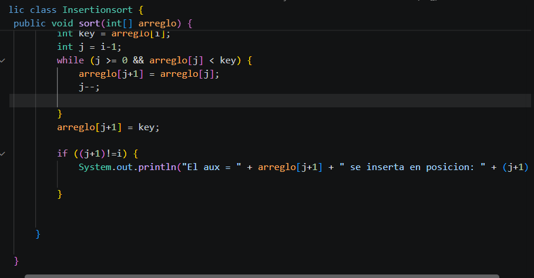
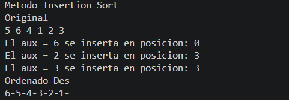

Metodo Insertionsort

Resultado

Comentario 

Para asegurar que salga el metodo insertior sort de manera descendente (mayor a menor) se ajusto la comparacion dentro del bucle en donde el numero en la posicion j[] sea menor al key. Al numero que queremos comparar con el resto del registro.
Ademas se incluyo un if para determinar si existe cambio. Ya que la posicion final del key es (j+1) y la inicial es igual a i. Si existio cambio ambas posiciones (indices) seran diferentes y si no existe cambio, son iguales noe entrando al bucle.